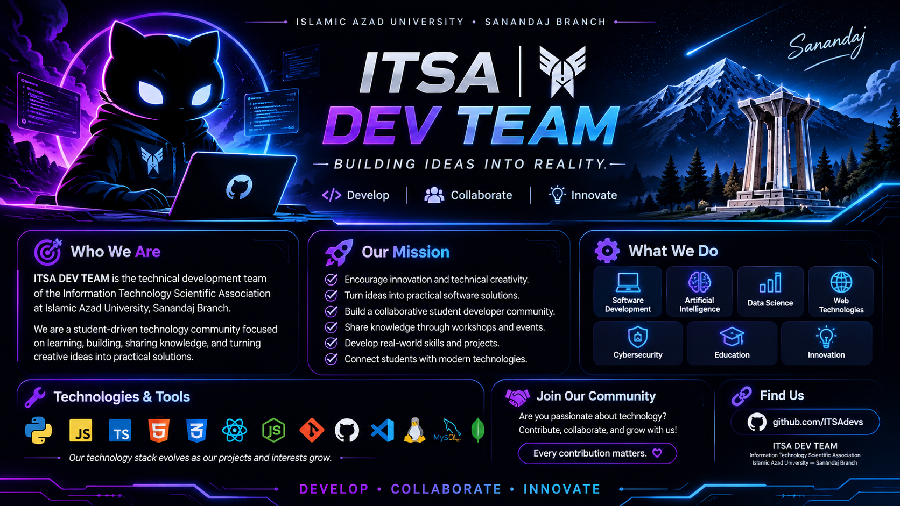

# 💻 ITSA DEV TEAM

  

<h1 align="center">⚡ ITSA DEV TEAM</h1>

<h3 align="center">
  Building Ideas Into Reality.
</h3>

  <b>Develop • Collaborate • Innovate</b>

  
  
  

---

## 👾 Who We Are

**ITSA DEV TEAM** is the technical development team of the Information Technology Scientific Association at Islamic Azad University, Sanandaj Branch.

We are a student-driven technology community focused on learning, building, sharing knowledge, and turning creative ideas into practical solutions.

Our goal is to create an environment where students can explore technology, develop real-world skills, collaborate on projects, and grow together as developers and innovators.

## 🎯 Our Mission

- 🚀 Encourage innovation and technical creativity.
- 💡 Turn ideas into practical software solutions.
- 🤝 Build a collaborative student developer community.
- 📚 Share knowledge through workshops and technical events.
- 🛠️ Develop practical skills through real-world projects.
- 🌐 Connect students with modern technologies and development practices.

## 🧠 What We Do

| Field | Activities |
|---|---|
| 💻 Software Development | Building software and web applications |
| 🤖 Artificial Intelligence | Exploring AI and Machine Learning |
| 📊 Data Science | Data analysis and intelligent solutions |
| 🌐 Web Technologies | Frontend and Backend development |
| 🔐 Cybersecurity | Learning secure development principles |
| 🎓 Education | Workshops, seminars and technical sessions |
| 💡 Innovation | Brainstorming and developing new ideas |

## ⚙️ Technologies & Tools

  

*Our technology stack evolves as our projects and interests grow.*

## 🏗️ Our Projects

We aim to develop and maintain projects that demonstrate our technical abilities, creativity, and teamwork.

Our repositories are intended to include:

- 📦 Student and team software projects
- 🧪 Experimental and research-oriented projects
- 🔧 Open-source tools and utilities
- 📚 Educational resources and learning materials
- 🌱 Innovative ideas and prototypes

**Stay tuned — more projects are coming!**

## 🤝 Join Our Community

Are you interested in programming, technology, artificial intelligence, or building something meaningful?

There is room for curious minds, creative thinkers, and passionate learners.

You can contribute by:

- Sharing innovative ideas.
- Participating in collaborative projects.
- Improving existing repositories.
- Reporting issues and suggesting features.
- Sharing knowledge and helping other developers.

Every contribution matters. 💜

## 🌐 Find Us

  

  <b>ITSA DEV TEAM</b> 
  Information Technology Scientific Association 
  Islamic Azad University — Sanandaj Branch

---

  <b>⚡ DEVELOP • COLLABORATE • INNOVATE ⚡</b>

  <i>Great things are built together.</i>

